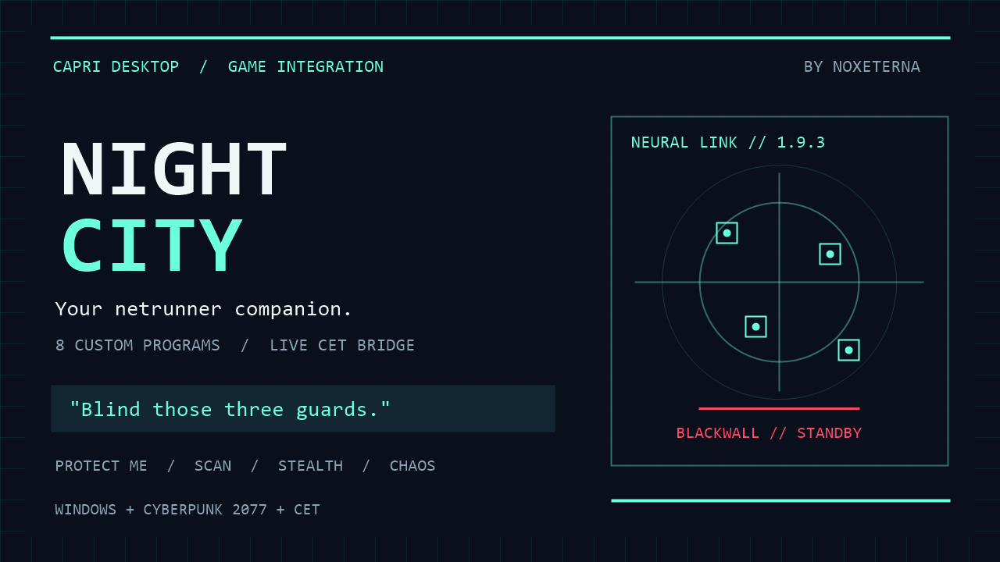

# Capri Night City

Bring Capri into Cyberpunk 2077: ask her to hack nearby NPCs, vehicles and devices, tag contacts through walls, protect V and cast eight custom netrunner programs.

- Kind: code mod
- Made by: NoxEterna
- Version: 1.9.3
- Platform: Windows
- Requires: Capri Desktop (interface checked with 0.8.5), Cyberpunk 2077 and Cyber Engine Tweaks (CET)



## What she can do

- **Natural commands and groups:** “flatline him”, “blind those three guards”, “stop the car” or “hack the camera”. Nearby-person commands choose an eligible NPC; “the guy in front of me” uses the crosshair. Groups affect up to five targets.
- **Eight custom programs:** Ghost Veil, Marionette Lock, Dead Channel, Neural Siphon, Furnace Lock, Circuit Breaker, Crash Loop and Reaper Thread. See [HACKS.md](HACKS.md).
- **Continuous scanning:** native scanner tags for eligible enemies, neutral NPCs and adult civilians, refreshed through walls within the configured range (35 metres by default).
- **Protect Me, stealth and chaos:** frequent defensive control hacks, quiet control programs, or optional autonomous actions against nearby supported NPCs, cars and devices.
- **Emergency rescue:** strictly below **50 raw HP**, request up to five hostile eliminations and heal V for **100 raw HP**, capped at maximum. Persistent **120-second cooldown**; suspended in stealth.
- **Netrunner defense:** retaliate against the actual incoming hacker/trace source with a silent body-drop request. Bodies remain discoverable.
- **Contextual reactions:** important game events can be rephrased by Capri's configured brain and personality, with bounded reporting and literal manual acknowledgements as fallback.

## Install both parts

The directory's Install button installs the Capri client only. The separate **CET game bridge is required** for commands to affect Cyberpunk.

1. Install [Capri Desktop](https://github.com/lachydotmcg/capri-desktop/releases) and [Cyber Engine Tweaks](https://github.com/maximegmd/CyberEngineTweaks/releases). Close Capri and Cyberpunk before copying files.
2. Download the [complete Night City 1.9.3 package](https://github.com/SzentiX/capri-mods/releases/download/night-city-v1.9.3/Capri-Night-City-1.9.3.zip) and extract it. Open the extracted folder containing `Install.ps1`. The same files are included here for source review and manual installation.
3. In PowerShell, run the installer with **your actual game folder**:

   ```powershell
   .\Install.ps1 -GameRoot 'D:\SteamLibrary\steamapps\common\Cyberpunk 2077'
   ```

   If Windows blocks the downloaded script, review it and use `Unblock-File .\Install.ps1` first. The installer checks the game executable and CET, copies only this mod's files, preserves existing tuning/settings, writes Capri's bridge location and prints the backup manifest path. Keep that path for rollback. It supports `-CapriData` for a nonstandard Capri data folder.

4. Start Capri, open **Mainframe > Mods**, and enable/approve **Capri Night City**. Start Cyberpunk and load a save. Say or type `night city status`, then `scan` or `protect me`.

### Manual installation

Copy this folder's `CapriNightCityBridge` directory to `<Cyberpunk 2077>\bin\x64\plugins\cyber_engine_tweaks\mods\CapriNightCityBridge`. Import `capri-night-city.capri-code` through Capri's Mods window (or install its directory entry), enable it and approve it. Say/type `night city connect` and select that **CapriNightCityBridge folder containing `init.lua`**, then load a save and check `night city status`.

There is no personal drive path or automatic game discovery in a fresh import. Update both the Capri file and CET bridge together; restart Capri and Cyberpunk and approve the changed code mod. A backup-aware installer can also stage an update with `-StageForRestart`; the running game keeps its old Lua until restarted.

## Try these commands

| Say or type | Result |
|---|---|
| `night city hacks` | Hear the custom program catalogue. |
| `flatline him` | Target a nearby eligible NPC, independent of the car under the crosshair. |
| `blind the guy in front of me` | Use the aimed NPC. |
| `use Ghost Veil on those three guards` | Group memory wipe and blindness. |
| `put him in a crash loop` | Timed electrical damage and weapon malfunction. |
| `scan` / `stop scanning` | Start continuous native tagging / clear owned tags. |
| `protect me` / `protection off` | Toggle defensive control hacks. |
| `stealth mode on` / `go loud` | Enable quiet control / leave stealth. |
| `chaos mode on` / `chaos mode off` | Toggle optional nearby-target chaos. |
| `netrunner defense on` / `counterhack off` | Toggle incoming-hacker retaliation. |
| `emergency off` / `emergency rescue on` | Disarm / arm the low-health rescue. |
| `stop the car` / `blow up the car` | Aim at a supported vehicle for braking / explosion. |
| `hack the camera` / `hack the access point` | Request an advertised device action / native network breach. |
| `stand down` | Disable autonomous modes/scanning and cancel tracked pending effects. |
| `night city status` / `night city dashboard` | Diagnose the bridge and current modes. |

The [complete command reference](COMMANDS.md) includes aliases, templates, targeting rules, cooldowns and mode interactions. Use one action per command; natural phrasing uses a bounded local grammar. Unmatched wording can go to ordinary conversation.

## Defaults, privacy and limits

Emergency rescue, netrunner defense and regular combat assistance start armed according to the bridge settings; chaos starts off. `stand down` disarms autonomous modes for the session. Configure range and intervals in the installed `CapriNightCityBridge/settings.json`; existing settings are preserved on update.

The bridge exchanges bounded local text files with Capri. Contextual reports pass selected game facts to **your configured Capri brain/provider**; a cloud provider therefore receives those facts. `night city quiet` stops ambient game reactions; `night city reactions` enables them again. No API key is bundled and there is no separate mod service or telemetry endpoint.

The game must expose loaded, eligible targets. Child, boss, quest-protected and immortal targets, V and V's occupied car are skipped. Scanning does not authorize automatic attacks on neutral NPCs; Protect Me targets hostiles. Device hacks require the device's advertised remote actions. Access-point breach does not fabricate datamine rewards or solve arbitrary minigame programs. Native scanning/cybereye restrictions and HUD settings still apply.

An upload acknowledgement confirms a request, not a confirmed death, explosion or rendered outline. Native effects and other mods can change outcomes. Ordinary manual/group hacks share an eight-second cooldown; Blackwall has a separate 180-second cooldown. Menus, stale connection and session changes stop work/clean up tracked effects. Completed deaths, explosions and breaches persist as game consequences.

Use typing or Capri's normal local-brain voice path for commands. The separate ElevenLabs agent voice route may bypass code-mod command dispatch. This mod uses internal Capri interfaces for brain reporting, which a future Capri update can change. See [VALIDATION.md](VALIDATION.md) for automated evidence and remaining runtime limits.

## Remove or roll back

Disable the code mod in Capri and close Cyberpunk. For an installer-managed deployment, use the exact manifest printed at install time:

```powershell
.\Uninstall.ps1 -Deployment '<game folder>\CapriNightCity-backups\<timestamp>\deployment.json'
```

Rollback checks every installed/backup hash and refuses to overwrite files edited since installation. It restores prior files or removes this installation's new files; it retains runtime data, user settings and unrelated mods. A manual installation can be removed by deleting only `CapriNightCityBridge` and removing the Capri mod after disabling it.

## Build and check

Run `Build.ps1` on Windows with Lua and its syntax checker available (tested with Lua 5.5), plus .NET Framework's C# compiler. Custom paths can be supplied using `-Lua` and `-Luac`. It runs Lua gameplay mocks, C#/protocol and cross-process fixtures, optional installed-Capri compilation and installer/rollback fixtures. It creates a complete installable ZIP under `out` with SHA-256 checksums. This is an unofficial fan integration and includes no game assets.
